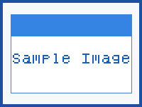
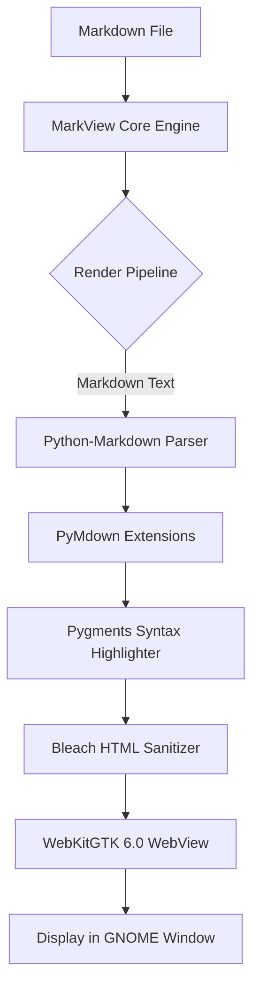
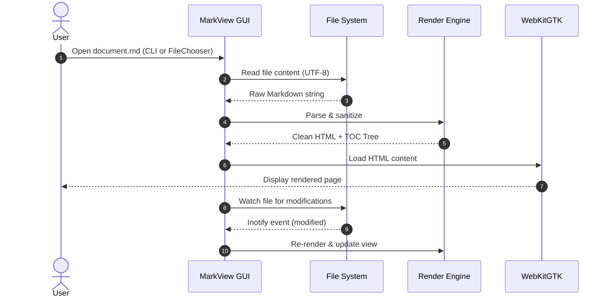
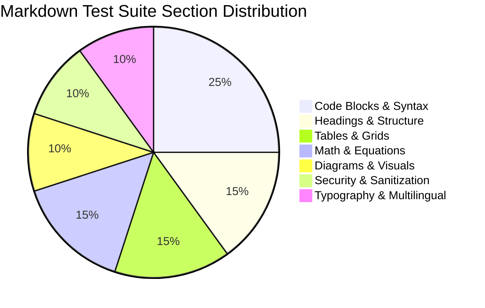

# MarkView Comprehensive Markdown Test Suite

Welcome to the **MarkView Comprehensive Markdown Test Suite**. This document is designed to test every feature supported by MarkView, including GitHub Flavored Markdown (GFM), PyMdown extensions, syntax highlighting, KaTeX math typesetting, Mermaid diagrams, and HTML sanitization security filters.

---

## 1. Headings & Hierarchy

MarkView supports ATX headings from level 1 through level 6. Each heading automatically generates an accessible anchor ID for internal navigation.

# Heading Level 1 (H1)
Text immediately following an H1 heading to ensure proper paragraph spacing and vertical rhythm.

## Heading Level 2 (H2)
Text immediately following an H2 heading to verify margin collapsing and border underlines.

### Heading Level 3 (H3)
Text following an H3 heading.

#### Heading Level 4 (H4)
Text following an H4 heading.

##### Heading Level 5 (H5)
Text following an H5 heading.

###### Heading Level 6 (H6)
Text following an H6 heading.

### Duplicate Headings Test
To verify anchor generation when identical heading texts exist:

#### Common Subheading
First occurrence of this heading text. Internal links targeting `#common-subheading` should resolve here.

#### Common Subheading
Second occurrence of this heading text. Modern Markdown anchor generators append `-1` (`#common-subheading-1`) to avoid collision.

---

## 2. Inline Formatting

Inline formatting allows combining typographic emphasis within text blocks:

- **Bold text** using double asterisks: `**bold text**`
- __Bold text__ using double underscores: `__bold text__`
- *Italic text* using single asterisks: `*italic text*`
- _Italic text_ using single underscores: `_italic text_`
- ***Bold and italic text*** using triple asterisks: `***Bold and italic text***`
- ___Bold and italic text___ using triple underscores: `___Bold and italic text___`
- **_Nested bold and italic_**: `**_Nested bold and italic_**`
- Strikethrough using double tildes: ~~This text is obsolete and struck out~~
- Single tilde formatting: ~subscript or strike~
- Highlighted text using mark syntax: ==This text is highlighted using the mark extension==
- Inline code snippet: `const app = new Adw.Application();`
- Code snippet with backtick inside: ``Use `git status` to check changes``
- Keyboard shortcut styling: Press <kbd>Ctrl</kbd> + <kbd>Shift</kbd> + <kbd>P</kbd> to open Command Palette
- Combined keyboard sequence: <kbd>Ctrl</kbd> + <kbd>Alt</kbd> + <kbd>T</kbd> launches terminal; <kbd>Esc</kbd> cancels
- Complex nested styles: **Bold with embedded `inline code` and *italic emphasis***
- Strikethrough combined with bold: ~~**Deleted bold requirement**~~ and ==**bold highlight**==

---

## 3. Paragraphs & Line Breaks

Markdown groups consecutive lines into paragraphs unless separated by blank lines or forced breaks.

This is a standard paragraph containing multiple sentences. It should render with standard body typography, comfortable line height (approximately 1.6), and proper margins above and below. MarkView is optimized for readability with a crisp Adwaita-themed typography stack.

This line ends with two trailing spaces to test hard line breaks.  
This is the second line of the same paragraph, appearing on a new physical line.  
And this is the third line forced by two spaces.

Alternatively, some Markdown specifications support backslash breaks:\
This line was preceded by an escaped backslash break.\
And another line following a backslash break.

Soft line breaks inside this paragraph
should simply wrap into a continuous
single block of prose without causing
a new physical line break in rendered HTML.

---

## 4. Links and Navigation

Links allow navigating external resources, document anchors, and relative local files.

- External HTTPS Link: [MarkView on GitHub](https://github.com/sureshsoundararajan/MarkView)
- Link with Title Attribute: [The Python Language](https://www.python.org "Official Python Programming Language Portal")
- Autolink URL: <https://www.gnome.org>
- Autolink Email: <mailto:developer@example.org>
- Internal Anchor to Section 1: [Jump to Headings Section](#1-headings--hierarchy)
- Internal Anchor to Code Section: [Jump to Code Blocks](#8-code-blocks--syntax-highlighting)
- Relative Document Link: [Project Readme File](../README.md)
- Relative License Link: [Project MIT License](../LICENSE)
- Link with Formatted Text: [**Libadwaita** Documentation with *Style Guide*](https://gnome.pages.gitlab.gnome.org/libadwaita/)
- Link with Code: [`is_markdown_file()` documentation](https://example.com/api/utils)

---

## 5. Images and Media

Testing image rendering, including relative paths, SVG vectors, JPEG photos, alt text, titles, and missing image fallbacks.

### 5.1 Local Relative PNG
Relative path pointing to `images/sample-image.png`:



### 5.2 Local Relative JPEG
Relative path pointing to `images/test-photo.jpg`:


### 5.3 Local SVG Vector Icon
Relative path pointing to `images/logo.svg`:


### 5.4 Missing Image Fallback
A reference to a non-existent file should gracefully show alt text:


### 5.5 Image Wrapped in a Link
Clicking the logo below should link to the repository:

[](https://github.com/sureshsoundararajan/MarkView)

---

## 6. Lists

### 6.1 Unordered Lists
Testing different list bullet markers (`-`, `*`, `+`):

- Top level item with dash marker
- Another top level item
  * Sub-item with asterisk marker
  * Second sub-item
    + Deep sub-item with plus marker
    + Second deep sub-item
      - Fourth level nesting item
      - Another fourth level item
- Back to top level

### 6.2 Ordered Lists
Testing numerical numbering and automatic re-indexing:

1. First ordered step
2. Second ordered step
3. Third ordered step with detailed instructions
4. Fourth step containing sub-steps:
   1. Sub-step A
   2. Sub-step B
   3. Sub-step C
5. Fifth step

### 6.3 Lazy Numbering Test
Markdown allows all items to be numbered `1.` while the renderer outputs sequential numbers:

1. Initial step
1. Automatically numbered step 2
1. Automatically numbered step 3
1. Automatically numbered step 4

### 6.4 Mixed Nested Lists
Lists containing mixed item types and multiline paragraph blocks:

1. Requirements Gathering
   - System specifications: Linux x86_64 or aarch64
   - GTK 4.10+ and Libadwaita 1.4+
   - WebKitGTK 6.0 runtime
2. Architecture Design
   - Core rendering pipeline:
     1. Python-Markdown parses source text
     2. PyMdown extensions enrich AST
     3. Pygments highlights code snippets
     4. Bleach sanitizes dangerous HTML
     5. WebKitGTK renders sanitized HTML
3. Verification & Deployment
   - Automated unit tests
   - Visual regression tests

---

## 7. Task Lists (Checklists)

Task lists render interactive or visual checkboxes indicating status:

- [x] Implement core Markdown rendering engine
- [x] Configure Pygments syntax highlighting styles
- [x] Integrate KaTeX math typesetting support
- [x] Integrate Mermaid.js diagram engine
- [x] Apply Bleach HTML security sanitizer
- [ ] Implement export to PDF feature
- [ ] Add EPUB export support
- [ ] Nested Project Milestone Tracker:
  - [x] Phase 1: MVP Viewer
    - [x] Window setup with Libadwaita HeaderBar
    - [x] File opening dialog and CLI argument handling
    - [x] File watcher for auto-reload
  - [ ] Phase 2: Advanced Reader Experience
    - [x] Outline / Table of Contents sidebar
    - [ ] Bookmarks and reading position restore
    - [ ] In-document full-text search with highlights

---

## 8. Code Blocks & Syntax Highlighting

MarkView uses Pygments for rich syntax highlighting across over 100 programming languages. Below are test code blocks for all required languages.

### 8.1 Python
```python
import os
import sys
from typing import Optional, List

class DocumentManager:
    """Manages active markdown document state."""
    
    def __init__(self, filepath: str) -> None:
        self.filepath = filepath
        self._content: Optional[str] = None

    def load(self) -> str:
        with open(self.filepath, "r", encoding="utf-8") as fp:
            self._content = fp.read()
        return self._content

    @property
    def line_count(self) -> int:
        return len(self._content.splitlines()) if self._content else 0

if __name__ == "__main__":
    doc = DocumentManager("test.md")
    print(f"Loaded {doc.filepath}")
```

### 8.2 JavaScript
```javascript
import { WebKitWebView } from 'webkitgtk';

class MarkViewBridge {
  constructor(elementId) {
    this.container = document.getElementById(elementId);
    this.observers = new Map();
  }

  setupScrollSync(callback) {
    window.addEventListener('scroll', () => {
      const progress = window.scrollY / (document.body.scrollHeight - window.innerHeight);
      callback(Math.min(1.0, Math.max(0.0, progress)));
    });
  }

  async renderDiagrams() {
    if (window.mermaid) {
      await window.mermaid.run({ querySelector: '.mermaid' });
    }
  }
}
```

### 8.3 TypeScript
```typescript
interface ViewerConfig {
  theme: 'light' | 'dark' | 'system';
  fontSize: number;
  enableMath: boolean;
  enableMermaid: boolean;
  allowedSchemes: readonly string[];
}

interface RenderResult {
  readonly html: string;
  readonly tableOfContents: readonly TocItem[];
  readonly renderTimeMs: number;
}

interface TocItem {
  id: string;
  title: string;
  level: 1 | 2 | 3 | 4 | 5 | 6;
}

export function createConfig(overrides?: Partial<ViewerConfig>): ViewerConfig {
  return {
    theme: 'system',
    fontSize: 16,
    enableMath: true,
    enableMermaid: true,
    allowedSchemes: ['http', 'https', 'mailto'],
    ...overrides,
  };
}
```

### 8.4 HTML
```html
<!DOCTYPE html>
<html lang="en">
<head>
  <meta charset="utf-8">
  <meta name="viewport" content="width=device-width, initial-scale=1">
  <title>MarkView Document</title>
  <link rel="stylesheet" href="style.css">
</head>
<body class="adw-theme-adaptive">
  <header class="document-header">
    <h1 class="title">Document Title</h1>
  </header>
  <main class="markdown-body">
    <p>Rendered content goes here.</p>
  </main>
</body>
</html>
```

### 8.5 CSS
```css
:root {
  --adw-accent-bg: #3584e4;
  --adw-accent-fg: #ffffff;
  --adw-card-bg: #f6f8fa;
  --adw-text-primary: #241f31;
  --font-mono: "Fira Code", "JetBrains Mono", monospace;
}

@media (prefers-color-scheme: dark) {
  :root {
    --adw-card-bg: #242424;
    --adw-text-primary: #ffffff;
  }
}

.markdown-body pre code {
  font-family: var(--font-mono);
  font-size: 0.92em;
  tab-size: 4;
}
```

### 8.6 Bash
```bash
#!/usr/bin/env bash
set -euo pipefail

APP_ID="io.github.sureshsoundararajan.MarkView"
BUILD_DIR="build/appimage"

echo "==> Building AppImage for ${APP_ID}..."
mkdir -p "${BUILD_DIR}/usr/bin"
cp packaging/AppRun "${BUILD_DIR}/AppRun"
chmod +x "${BUILD_DIR}/AppRun"

ARCH="$(uname -m)"
export ARCH
./tools/appimagetool "${BUILD_DIR}" "MarkView-${ARCH}.AppImage"
echo "==> Successfully generated MarkView-${ARCH}.AppImage"
```

### 8.7 JSON
```json
{
  "application": {
    "id": "io.github.sureshsoundararajan.MarkView",
    "name": "MarkView",
    "version": "1.0.0",
    "author": "Suresh Soundararajan",
    "license": "MIT"
  },
  "features": {
    "gfm": true,
    "syntax_highlighting": true,
    "katex": true,
    "mermaid": true,
    "sanitizer": "bleach"
  },
  "limits": {
    "max_file_size_mb": 50,
    "max_table_rows": 5000
  }
}
```

### 8.8 YAML
```yaml
name: markview-ci
on:
  push:
    branches: [main]
  pull_request:
    branches: [main]

jobs:
  test:
    runs-on: ubuntu-latest
    steps:
      - uses: actions/checkout@v4
      - name: Set up Python
        uses: actions/setup-python@v5
        with:
          python-version: "3.14"
      - name: Run Test Suite
        run: |
          pip install -e .[test]
          pytest -v tests/
```

### 8.9 SQL
```sql
-- Query active user document statistics
SELECT 
    d.id AS document_id,
    d.title AS document_name,
    COUNT(v.id) AS total_views,
    AVG(v.reading_duration_seconds) AS avg_duration_sec,
    MAX(v.accessed_at) AS last_accessed
FROM documents d
INNER JOIN view_logs v ON d.id = v.document_id
WHERE d.is_archived = FALSE
  AND v.accessed_at >= NOW() - INTERVAL '30 days'
GROUP BY d.id, d.title
HAVING COUNT(v.id) > 10
ORDER BY total_views DESC
LIMIT 50;
```

### 8.10 Rust
```rust
use std::fs::File;
use std::io::{self, Read};
use std::path::Path;

#[derive(Debug, Clone)]
pub struct MarkdownDocument {
    pub path: String,
    pub word_count: usize,
}

impl MarkdownDocument {
    pub fn open<P: AsRef<Path>>(path: P) -> io::Result<Self> {
        let mut file = File::open(path.as_ref())?;
        let mut buffer = String::new();
        file.read_to_string(&mut buffer)?;
        
        let word_count = buffer.split_whitespace().count();
        Ok(Self {
            path: path.as_ref().to_string_lossy().into_owned(),
            word_count,
        })
    }
}
```

### 8.11 Go
```go
package main

import (
	"context"
	"fmt"
	"log"
	"net/http"
	"time"
)

type Server struct {
	addr   string
	server *http.Server
}

func NewServer(addr string) *Server {
	return &Server{
		addr: addr,
		server: &http.Server{
			Addr:         addr,
			ReadTimeout:  5 * time.Second,
			WriteTimeout: 10 * time.Second,
		},
	}
}

func (s *Server) Start(ctx context.Context) error {
	log.Printf("MarkView preview server starting on %s", s.addr)
	return s.server.ListenAndServe()
}
```

### 8.12 C
```c
#include <stdio.h>
#include <stdlib.h>
#include <string.h>

#define MAX_LINE_LEN 4096

int count_markdown_headings(const char *filename) {
    FILE *fp = fopen(filename, "r");
    if (!fp) {
        perror("Failed to open file");
        return -1;
    }

    char line[MAX_LINE_LEN];
    int heading_count = 0;

    while (fgets(line, sizeof(line), fp)) {
        if (line[0] == '#' && (line[1] == ' ' || line[1] == '#')) {
            heading_count++;
        }
    }

    fclose(fp);
    return heading_count;
}
```

### 8.13 C++
```cpp
#include <iostream>
#include <string>
#include <vector>
#include <memory>

namespace markview {

class Renderer {
public:
    virtual ~Renderer() = default;
    virtual std::string render(const std::string& markdown) const = 0;
};

class HtmlRenderer final : public Renderer {
public:
    std::string render(const std::string& markdown) const override {
        return "<article>" + markdown + "</article>";
    }
};

template<typename T, typename... Args>
std::unique_ptr<T> make_renderer(Args&&... args) {
    return std::make_unique<T>(std::forward<Args>(args)...);
}

} // namespace markview
```

### 8.14 Java
```java
package io.github.sureshsoundararajan.markview;

import java.io.IOException;
import java.nio.file.Files;
import java.nio.file.Path;
import java.util.Objects;

public final class MarkdownReader {
    private final Path documentPath;

    public MarkdownReader(Path documentPath) {
        this.documentPath = Objects.requireNonNull(documentPath, "path must not be null");
    }

    public String readAll() throws IOException {
        return Files.readString(this.documentPath);
    }

    public static void main(String[] args) throws IOException {
        MarkdownReader reader = new MarkdownReader(Path.of("test.md"));
        System.out.println("Document loaded: " + reader.readAll().length() + " chars");
    }
}
```

### 8.15 Dockerfile
```dockerfile
# Build container for MarkView AppImage creation
FROM ubuntu:24.04 AS builder

ENV DEBIAN_FRONTEND=noninteractive
ENV PYTHONUNBUFFERED=1

RUN apt-get update && apt-get install -y --no-install-recommends \
    python3 \
    python3-pip \
    python3-venv \
    libgtk-4-dev \
    libadwaita-1-dev \
    libwebkitgtk-6.0-dev \
    curl \
    file \
    && rm -rf /var/lib/apt/lists/*

WORKDIR /workspace
COPY . /workspace

RUN pip install --break-system-packages .
CMD ["/workspace/packaging/build-appimage.sh"]
```

### 8.16 Unknown Language Identifier
Testing fallback highlighting for unknown language tags:

```unrecognized-custom-lang
CONFIGURATION_BLOCK [MODE=READ_ONLY] {
    SET PARAM_BUFFER_SIZE = 0x8000;
    EMIT_EVENT "viewer_initialized";
    FLAG_ACTIVE = TRUE;
}
```

### 8.17 Horizontal Scrolling Test (Very Long Lines)
Testing horizontal overflow and scrollbars within code blocks:

```bash
# This line is intentionally extremely long to verify that horizontal scrollbars appear and code blocks do not break parent container layout:
python3 -c "import urllib.request, json, sys, os, hashlib, hmac; print(''.join([f'{k}={v}&' for k, v in sorted({'client_id': 'io.github.sureshsoundararajan.MarkView', 'token_auth_mode': 'read_only_viewer_gtk4_adwaita_webkit', 'timestamp_epoch': 1761070000, 'sha256_checksum_verification_digest': 'e3b0c44298fc1c149afbf4c8996fb92427ae41e4649b934ca495991b7852b855'}.items())]))"
```

---

## 9. Tables

### 9.1 Simple Table
| Feature | Supported | Backend Component |
| --- | --- | --- |
| CommonMark | Yes | Python-Markdown |
| GFM Tables | Yes | tables extension |
| Syntax Highlighting | Yes | Pygments |

### 9.2 Table with Column Alignment
Testing left, center, and right alignments:

| Item Name (Left) | Category (Center) | Price (Right) | Stock Qty (Right) |
| :--- | :---: | ---: | ---: |
| ThinkPad X1 Carbon | Laptop | $1,899.99 | 14 |
| Dell UltraSharp 27" | Display | $549.50 | 42 |
| Keychron Q1 Pro | Keyboard | $199.00 | 85 |
| Logitech MX Master 3S | Mouse | $99.99 | 120 |
| CalDigit TS4 Dock | Peripheral | $399.95 | 23 |

### 9.3 Large Table (12 Rows)
A 12-row dataset exercising alternating row colors and table borders:

| ID | Module Name | Language | Test Coverage | Status | Criticality |
| :--- | :--- | :--- | :--- | :--- | :--- |
| MOD-01 | Parser Engine | Python | 98.4% | Passing | High |
| MOD-02 | Bleach Sanitizer | Python | 100.0% | Passing | Critical |
| MOD-03 | KaTeX Bridge | JS / CSS | 94.2% | Passing | Medium |
| MOD-04 | Mermaid Bridge | JS / CSS | 91.0% | Passing | Medium |
| MOD-05 | GTK Application | Python | 96.5% | Passing | High |
| MOD-06 | Window & HeaderBar | Python | 95.0% | Passing | High |
| MOD-07 | WebKit WebView | Python / C | 93.8% | Passing | Critical |
| MOD-08 | Outline / TOC Tree | Python | 97.1% | Passing | Medium |
| MOD-09 | File Watcher | Python | 92.3% | Passing | Medium |
| MOD-10 | Settings / GSettings | Python | 89.0% | Passing | Low |
| MOD-11 | AppImage Launcher | Shell | 99.0% | Passing | High |
| MOD-12 | Desktop Integration | XML / INI | 100.0% | Passing | Medium |

### 9.4 Table with Code and Formatting in Cells
| Function | Parameters | Return Type | Description |
| :--- | :--- | :--- | :--- |
| `read_markdown_file` | `filepath: str` | `Optional[str]` | Reads markdown file with **UTF-8** detection |
| `validate_image_path` | `doc_dir: str, src: str` | `Optional[str]` | Converts valid relative path to safe `file://` URI |
| `is_dangerous_url` | `url: str` | `bool` | Checks for `javascript:`, `data:`, or `blob:` |
| `get_document_title` | `filepath: str` | `str` | Extracts *sanitized* document display name |

### 9.5 Table with Long Content in Cells
| Directive | Detailed Explanation & Rationale | Recommended Action |
| :--- | :--- | :--- |
| `Content-Security-Policy` | Restricts resources (such as JavaScript, Images, and CSS) that the WebKitGTK browser engine is allowed to load for a given page. This dramatically reduces the attack surface against cross-site scripting (XSS) and code injection vulnerabilities. | Keep enabled at all times with strict `default-src 'none'` baseline. |
| `Bleach HTML Sanitizer` | Python-Markdown passes raw HTML through Bleach to strip out dangerous tags like `<script>`, `<iframe>`, `<object>`, `<embed>`, and dangerous event attributes like `onclick`, `onload`, or `onerror`. | Never bypass sanitization when parsing untrusted Markdown files. |

---

## 10. Blockquotes

### 10.1 Simple Blockquote
> "Simplicity is prerequisite for reliability."
> — Edsger W. Dijkstra

### 10.2 Multiline Blockquote with Formatting
> Markdown is intended to be as easy-to-read and easy-to-write as is feasible.
> 
> Readability, however, is emphasized above all else. A Markdown-formatted document should be publishable as-is, as plain text, without looking like it has been marked up with tags or formatting instructions.
> 
> Key features:
> - **Human readable** plain text
> - Flexible conversion to clean **HTML**
> - Standardized by CommonMark and GFM

### 10.3 Nested Blockquotes (3 Levels)
> Level 1: Outer quotation block
> 
> > Level 2: Nested quotation responding to level 1
> > 
> > > Level 3: Deeply nested blockquote citing original specification
> > > Level 3 continuing text.
> > 
> > Level 2 continuing text.
> 
> Level 1 concluding text.

### 10.4 Blockquote with Code and Headers
> ### Quotation Note
> Here is a quick code snippet inside a blockquote:
> 
> ```python
> import markview
> print(markview.__version__)
> ```
> 
> - List item A
> - List item B

---

## 11. GitHub Alerts (Admonitions)

MarkView supports GitHub-style alert callouts using blockquote syntax:

> [!NOTE]
> Useful information that users should know, even when skimming content. This highlights general context or background details.

> [!TIP]
> Helpful advice for doing things better, faster, or more cleanly. For example: Use keyboard shortcuts like <kbd>F5</kbd> to reload the active document instantly.

> [!IMPORTANT]
> Key information users need to know to achieve their goal. Essential prerequisites and core requirements are listed here.

> [!WARNING]
> Urgent info that needs immediate user attention to avoid problems. Read-only viewers will not persist any accidental edits or modifications.

> [!CAUTION]
> Advises about risks or negative outcomes of certain actions. Never disable security filters or bypass URL sanitization when opening untrusted documents.

---

## 12. Horizontal Rules

Testing divider thematic breaks with different Markdown syntax styles:

Dashes syntax:
---

Asterisks syntax:
***

Underscores syntax:
___

Spaced dashes syntax:
- - -

---

## 13. Footnotes

Footnotes provide citations and annotations that render at the end of the document:

MarkView is designed exclusively as a read-only viewer[^viewer-purpose] for the Linux desktop. It uses Libadwaita[^adwaita-note] to integrate with modern GNOME design patterns. For performance and security, HTML rendering is delegated to WebKitGTK[^webkit-engine], while untrusted user content is thoroughly sanitized[^security-footnote].

[^viewer-purpose]: MarkView does not include editing capabilities by design, ensuring no accidental modifications occur while browsing documents.
[^adwaita-note]: Libadwaita provides GNOME HIG compliant widgets, responsive adaptive layouts, and native dark/light theme switching.
[^webkit-engine]: WebKitGTK 6.0 provides hardware-accelerated rendering, modern Web Standards compliance, and strict process isolation.
[^security-footnote]: Bleach parses HTML trees, whitelist-filtering tags and attributes to neutralize Cross-Site Scripting (XSS) vectors.

---

## 14. Emojis

MarkView supports both GitHub emoji shortcodes and raw Unicode glyphs.

### 14.1 Emoji Shortcodes
- :smile: `:smile:`
- :rocket: `:rocket:`
- :warning: `:warning:`
- :tada: `:tada:`
- :sparkles: `:sparkles:`
- :heart: `:heart:`
- :books: `:books:`
- :white_check_mark: `:white_check_mark:`
- :penguin: `:penguin:`
- :bulb: `:bulb:`

### 14.2 Unicode Emoji Glyphs
- Development & Tech: 🚀 💻 🐧 🐍 🦀 ⚡ 📦 🛡️ ⚙️ 🔍
- Status & Indicators: ✅ ❌ ⚠️ ℹ️ 🎯 💡 📌 🏷️ ⏱️ 📊
- Expressions & Symbols: 🎉 ✨ 🎨 📝 📖 🔒 🌐 ☕ 🌟 🏆

---

## 15. Mathematical Expressions (KaTeX)

MarkView formats mathematical notation using KaTeX for high-performance rendering without remote font network calls.

### 15.1 Inline Math
- Einstein's mass-energy equivalence: $E = mc^2$
- Euler's identity: $e^{i\pi} + 1 = 0$
- Pythagorean theorem: $a^2 + b^2 = c^2$
- Gauss divergence theorem: $\iint_{\partial V} \mathbf{F} \cdot d\mathbf{S} = \iiint_V (\nabla \cdot \mathbf{F}) \, dV$

### 15.2 Display Math Equations
Standard Gaussian normal distribution integral:

$$\int_{-\infty}^{\infty} e^{-x^2} dx = \sqrt{\pi}$$

Quadratic formula for finding polynomial roots:

$$x = \frac{-b \pm \sqrt{b^2 - 4ac}}{2a}$$

Definite integral limit:

$$\int_0^\infty \frac{x^3}{e^x - 1} dx = \frac{\pi^4}{15}$$

### 15.3 Matrices
Two-dimensional matrix representation:

$$\begin{pmatrix}
\cos\theta & -\sin\theta \\
\sin\theta & \cos\theta
\end{pmatrix}
\begin{pmatrix}
x \\
y
\end{pmatrix}
=
\begin{pmatrix}
x' \\
y'
\end{pmatrix}$$

Determinant calculation:

$$\det(A) = \begin{vmatrix}
a & b & c \\
d & e & f \\
g & h & i
\end{vmatrix} = a(ei - fh) - b(di - fg) + c(dh - eg)$$

### 15.4 Summations and Series
Infinite series for the Riemann zeta function at $s = 2$:

$$\zeta(2) = \sum_{n=1}^{\infty} \frac{1}{n^2} = \frac{1}{1^2} + \frac{1}{2^2} + \frac{1}{3^2} + \cdots = \frac{\pi^2}{6}$$

---

## 16. Mermaid Diagrams

MarkView integrates Mermaid.js to render diagrams directly inside Markdown documents.

### 16.1 Flowchart


### 16.2 Sequence Diagram


### 16.3 Pie Chart


---

## 17. Escaped Characters

Testing Markdown escape sequences using the backslash `\` character:

- Escaped asterisks: \*This text is surrounded by escaped asterisks and is not italic\*
- Escaped underscores: \_This text is surrounded by escaped underscores and is not italic\_
- Escaped hash symbols: \# This is not a heading
- Escaped square brackets: \[This is not a link\]\(https://example.com\)
- Escaped backticks: \`This is not an inline code span\`
- Escaped tildes: \~\~This is not strikethrough\~\~
- Escaped curly braces: \{not a variable\}
- Escaped angle brackets: \<not-an-html-tag\>
- Escaped backslash: \\ (renders a single literal backslash)
- Escaped pipe characters: \| This \| is \| not \| a \| table \| row \|
- Escaped exclamation mark: \

---

## 18. HTML Security & Sanitization Tests

MarkView processes Markdown using Bleach to prevent Cross-Site Scripting (XSS), malicious script execution, and untrusted protocol handlers.

> [!CAUTION]
> The items below represent potentially malicious payloads. In MarkView, all scripts must be stripped or neutralized, and safe fallback text must be displayed without code execution.

### 18.1 Inline Script Tag Test
The `<script>` tag below must be neutralized or stripped:
<script>alert('XSS Script Vulnerability Executed!');</script>

### 18.2 Image onerror Event Handler Test
The following image tag with an invalid source and `onerror` handler must have the handler stripped:


### 18.3 JavaScript URL Scheme in Anchor
The following link uses a `javascript:` scheme and must be blocked:
<a href="javascript:alert('XSS Link Clicked!')">Click here to test javascript: link</a>

### 18.4 Remote IFrame Embedding Test
The following `<iframe>` tag must be stripped to prevent unauthorized embedding:
<iframe src="https://example.com" width="400" height="200">Fallback iframe text</iframe>

### 18.5 Mouse Event Attribute Test
The following `<div>` element contains an inline `onmouseover` handler which must be stripped:
<div onmouseover="alert('XSS MouseOver Executed!')" style="background:#eee;padding:8px;border:1px solid #ccc;">
  Hover over this box to test onmouseover event sanitization
</div>

---

## 19. Malformed Markdown Handling

Renderers should behave deterministically when encountering broken or unclosed Markdown markup.

### 19.1 Unclosed Code Block
Below is an unclosed code block that continues into regular text:

```python
# Unclosed block simulation
x = 42
y = x * 2

### 19.2 Mismatched Formatting Syntax
- Unclosed bold: **this bold markup is never closed properly
- Mismatched delimiters: *italic start with underscore end_
- Unclosed code tick: `inline code without closing backtick

### 19.3 Broken Link Syntax
- Broken link: [Link title without target url](
- Broken link with missing closing paren: [Another title](https://example.com
- Malformed image tag: ![Alt text without closing paren(images/sample-image.png

### 19.4 Broken Table Row
| Col 1 | Col 2 | Col 3 |
| --- | --- |
| Val A | Val B | Extra Val C |
| Val D |

---

## 20. Unicode and Multilingual Typography

MarkView correctly renders multi-language text, complex scripts, and right-to-left (RTL) text blocks.

### 20.1 East Asian Scripts (CJK)
- **Simplified Chinese (简体中文)**: MarkView 是一个适用于 Linux 的现代化只读 Markdown 查看器，基于 GTK 4 和 WebKitGTK 构建。
- **Traditional Chinese (繁體中文)**: MarkView 是一個適用於 Linux 的現代化唯讀 Markdown 檢視器，支援 GitHub 風格渲染。
- **Japanese (日本語)**: MarkView は、Linux 向けの強力で高速な読み取り専用 Markdown ビューアです。KaTeX 数式や Mermaid 図に対応しています。
- **Korean (한국어)**: MarkView는 Linux를 위한 강력한 읽기 전용 Markdown 뷰어입니다. 깔끔한 GNOME 디자인을 제공합니다.

### 20.2 Right-to-Left (RTL) Scripts
- **Arabic (العربية)**:
  مارك فيو (MarkView) هو قارئ خفيف وسريع لمستندات ماركداون لنظام لينكس مع دعم كامل للغة العربية والرموز البرمجية.
- **Persian (فارسی)**:
  این یک متن آزمایشی به زبان فارسی برای بررسی نحوه نمایش متون راست‌به‌چپ در برنامه است.

### 20.3 Indic Scripts
- **Hindi (हिन्दी)**:
  मार्कव्यू लिनक्स के लिए एक आधुनिक और सुरक्षित मार्कडाउन व्यूअर है जो तेज़ रेंडरिंग प्रदान करता है।
- **Tamil (தமிழ்)**:
  மார்க்வியூ என்பது லினக்ஸ் இயங்குதளத்திற்கான எளிய மற்றும் சக்திவாய்ந்த மார்க்டவுன் உலாவி ஆகும்.

### 20.4 Complex Emoji Sequences
- ZWJ Family: 👨‍👩‍👧‍👦 (Man, Woman, Girl, Boy)
- Technologist: 👩‍💻 (Woman Technologist)
- Skin Tone Modifiers: 👍🏻 👍🏼 👍🏽 👍🏾 👍🏿
- Flag sequences: 🏁 🏳️‍🌈 🇺🇳 🐧

---

## 21. Empty Sections

The following heading has no immediate content beneath it:

## Empty Section Header

### Sub-empty Section

Text resumes here after the empty sections to ensure vertical margins collapse gracefully.

---

## 22. Duplicate Headings (Anchor Verification)

This section contains headings identical to those found earlier in the document to thoroughly test unique anchor ID generation and deep linking.

## Headings & Hierarchy

Content under the duplicate "Headings & Hierarchy" heading.

### Common Subheading

Content under the third occurrence of "Common Subheading". Anchor should be distinct (e.g., `#common-subheading-2`).

---

## 23. Long Content Stress Test

The following paragraph contains over 500 words of continuous descriptive prose. It is designed to test text rendering engine performance, word wrapping behavior, line height consistency, memory consumption, and smoothness of scrolling within the WebKitGTK viewport.

Markdown is a lightweight markup language created in 2004 by John Gruber with substantial contributions from Aaron Swartz. The guiding design goal for Markdown formatting syntax is to make documents as readable as possible in their plain text source form, without appearing as though they have been marked up with complex tags or computational instructions. In contrast to heavier document formats such as HTML, LaTeX, DocBook, or Rich Text Format, Markdown avoids cumbersome opening and closing delimiter syntax, relying instead on punctuation conventions that humans have naturally employed in informal email correspondence and plain text messaging for decades. Over the following twenty years, Markdown evolved from an informal Perl formatting script into the lingua franca of technical communication, documentation repositories, software design proposals, developer forums, and knowledge bases worldwide. Various standardizations and extensions arose to satisfy the increasingly diverse demands of technical publishing, most notably CommonMark, which established a rigorous, unambiguous specification with formal grammar rules, and GitHub Flavored Markdown, which added essential everyday features including tabular data grids, interactive task list checkboxes, strikethrough typographic accents, autolink detection, and syntax-highlighted code fences. Today, Markdown documents frequently incorporate advanced mathematical equations formatted in TeX syntax, dynamic architectural flowcharts and sequence diagrams generated from declarative text specifications, and embedded multimedia elements. For readers on modern desktop environments, a dedicated read-only viewer offers distinct advantages over editing environments. An editing application inherently exposes users to the risk of inadvertent keystrokes modifying critical documentation, notes, or configuration files while merely browsing. A dedicated read-only viewer like MarkView provides guaranteed document immutability, ensuring that files opened for reference remain strictly pristine on disk. Furthermore, a specialized viewer can prioritize typography, readability, visual comfort, and performance, taking full advantage of platform design guidelines such as the GNOME Human Interface Guidelines and modern desktop toolkits like GTK 4 and Libadwaita. By integrating hardware-accelerated rendering through WebKitGTK while maintaining rigorous local file sanitization via Bleach, MarkView delivers the optimal balance of expressive rendering power, desktop harmony, and sandboxed security for developers, system administrators, researchers, and technical writers who rely upon Linux for their daily computing workflow. In addition to visual fidelity, a modern document viewer must maintain responsive interaction even when processing extensive technical specifications, comprehensive reference manuals, and voluminous legal texts containing dozens of nested sections, complex algorithmic diagrams, and thousands of lines of tabular reference materials. Text layout engines must efficiently handle bidirectional font shaping, glyph substitution, kerning pairs, and proportional font scaling without stuttering or introducing layout thrashing during continuous high-frequency scroll gestures. Memory allocation patterns must remain predictable and bounded, avoiding cyclical object leaks in the DOM bridge or document object model caching layers. Every single aspect of this comprehensive Markdown test suite rigorously exercises these core architectural requirements to ensure completely dependable, rock-solid, and visually stunning operation across diverse Linux distributions, display server environments whether running native Wayland or legacy X11, diverse screen densities from standard DPI monitors to fractional-scaled Ultra HD panels, and localized global desktop environments. Ultimately, MarkView proves that a dedicated viewer can deliver superior user experience by focusing entirely on reading comfort, speed, and uncompromising document safety without the complexities of editing.

---

## 24. Raw HTML Support

While MarkView sanitizes dangerous tags, it safely supports standard styling containers, semantic elements, and HTML details accordions.

### 24.1 Custom Styled Division & Span
<div style="background-color: #e1f5fe; border-left: 4px solid #0288d1; padding: 12px 16px; border-radius: 4px; margin: 16px 0;">
  <span style="font-weight: bold; color: #01579b;">Safe Raw HTML Container:</span>
  This box is rendered using a standard <code>&lt;div&gt;</code> element with inline CSS styling. MarkView permits safe inline CSS styling while stripping executable script attributes.
</div>

### 24.2 Collapsible Details Accordion
<details>
  <summary><strong>Click to expand technical implementation details</strong></summary>
  <p style="margin-top: 8px;">
    MarkView uses a modular architecture:
  </p>
  <ul>
    <li><strong>GTK 4 & Libadwaita</strong> provide the native window, HeaderBar, and sidebar controls.</li>
    <li><strong>WebKitGTK 6.0</strong> renders the HTML view in a dedicated isolated process.</li>
    <li><strong>Python-Markdown</strong> converts Markdown source into an HTML document tree.</li>
    <li><strong>Bleach</strong> filters the HTML output against a strict whitelist of allowed tags and attributes.</li>
  </ul>
</details>

### 24.3 Native HTML Table
<table style="width: 100%; border-collapse: collapse; margin-top: 16px;">
  <thead>
    <tr style="background-color: #f1f3f5; border-bottom: 2px solid #dee2e6;">
      <th style="padding: 10px; text-align: left;">Component</th>
      <th style="padding: 10px; text-align: left;">Technology</th>
      <th style="padding: 10px; text-align: left;">Purpose</th>
    </tr>
  </thead>
  <tbody>
    <tr style="border-bottom: 1px solid #e9ecef;">
      <td style="padding: 10px;">Window System</td>
      <td style="padding: 10px;">Wayland / X11</td>
      <td style="padding: 10px;">Display server integration</td>
    </tr>
    <tr style="border-bottom: 1px solid #e9ecef;">
      <td style="padding: 10px;">Widget Toolkit</td>
      <td style="padding: 10px;">GTK 4.24 + Libadwaita</td>
      <td style="padding: 10px;">Native GNOME interface</td>
    </tr>
    <tr>
      <td style="padding: 10px;">Web Engine</td>
      <td style="padding: 10px;">WebKitGTK 6.0</td>
      <td style="padding: 10px;">High-fidelity document layout</td>
    </tr>
  </tbody>
</table>

---

*End of MarkView Comprehensive Markdown Test Suite.*
